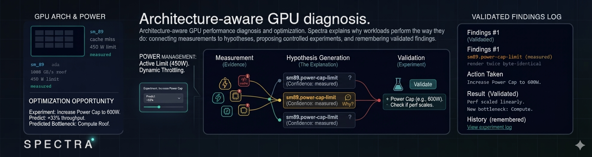

# Spectra



Architecture-aware GPU performance diagnosis and optimization.

Spectra explains why GPU workloads perform the way they do. It connects measurements to hypotheses, proposes controlled experiments, and remembers validated findings. It does not replace Nsight, nvidia-smi, or your inference engine's own metrics. Those produce numbers. Spectra explains them and keeps the explanation attached to the evidence.

## What it does

1. **Fingerprint**: Capture the hardware, software, workload, configuration, measurements, and environmental conditions needed to reproduce a performance result.
2. **Diagnose**: Correlate telemetry, traces, and hardware counters to identify candidate bottlenecks with evidence-backed confidence levels.
3. **Optimize**: Propose the smallest experiment that can confirm or reject each hypothesis, with explicit success criteria and rollback.

## Quick start

Install from source:

```bash
pip install .
```

Phase 1 (the walking skeleton) observes a live inference server, writes a structured run record, and renders a correlated report.

```bash
spectra observe --target 127.0.0.1:5804 --duration 120 --hz 2
spectra report runs/<id>.json
```

Run the test suite (no GPU or server needed):

```bash
python -m unittest discover -s tests
```

See `docs/DESIGN.md` for the architecture, data model, and rule engine. See `docs/MILESTONE-1.md` for the commit-by-commit implementation plan.

## Scope

Initial target: NVIDIA Ada Lovelace (sm_89), local LLM inference workloads. The adapter and rule boundaries keep other architectures and engines addable without core changes.

## Documentation

- [DESIGN.md](docs/DESIGN.md) — Architecture, data model, rule engine, roadmap
- [VISION.md](docs/VISION.md) — Broad vision and long-term direction (consolidated from SMTrace)
- [MILESTONE-1.md](docs/MILESTONE-1.md) — Phase 1 implementation plan with acceptance tests

### Milestone 1 research design

- [CONSOLIDATION.md](docs/CONSOLIDATION.md) — What SMTrace and AdaScope contribute: kept, merged, redesigned, deferred, and what to preserve before archival
- [RESEARCH.md](docs/RESEARCH.md) — Prior art, what the tools already on this machine already solve, and the contribution that remains
- [EVAL.md](docs/EVAL.md) — The falsifiable evaluation design: one question, three hypotheses, the smallest separating experiment, and what counts as inconclusive

## Status

76 unit tests pass. 8 skip without GPU, engine, or opt-in. The recorded-counter check passes at 109.1 tok/s, factor 3.02, ceiling 167.1, ratio 0.65.

One 60 s loaded run against the live backend gave 104.6 tok/s over 45 requests at 427 W mean against the 450 W limit. No rule fired. Power sat at 0.95 of limit while the ratio sat at 0.77, below both firing bands.

The control stage has not passed yet. Ten repetitions came back inconclusive. The backend unloads 5 minutes after load while a stage needs 10 or more, so later repetitions lose the engine. Eval runs need a longer unload timeout. The treatment stage needs `nvidia-smi -pl`, which needs a password this setup lacks, so it records inconclusive.

This engine build exposes no `/metrics`, so counter series are absent and the request log carries the rate and the spec factor. The counter path wins whenever counters exist.

## Long-term direction

Build a system that learns which optimization experiments work for a specific hardware and workload combination, and keeps the evidence needed to reproduce the result. The intended outcome is less guesswork, fewer ineffective tuning changes, and a growing library of validated GPU optimization knowledge.
